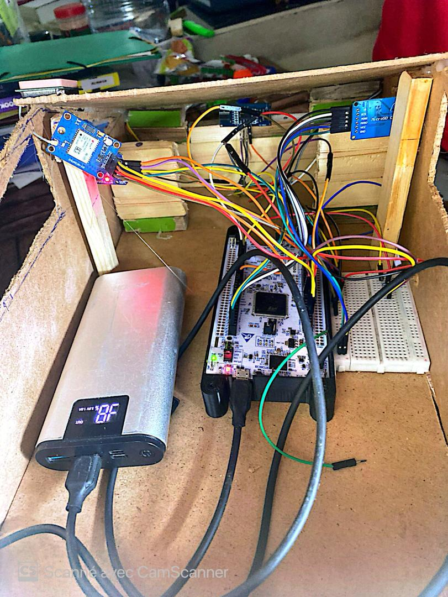
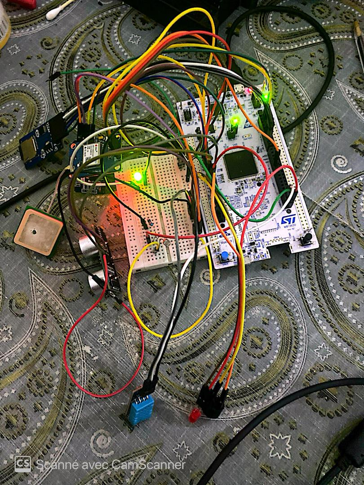
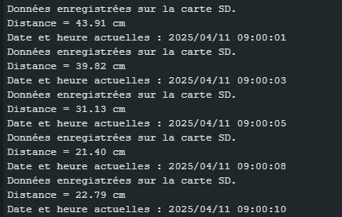

#  STM32 Automotive Telemetry & Datalogging System

##  Aperçu du Projet
Ce projet est un prototype de système embarqué d'acquisition de données (Datalogger) conçu pour l'environnement automobile. Développé en C++ (Bare-metal / Framework Arduino) sur une carte **STM32 Nucleo**, il simule la collecte en temps réel des télémétries d'un véhicule et leur stockage sécurisé.

Le système intègre la gestion de multiples bus de communication (I2C, SPI, UART) pour interagir avec un ensemble complet de capteurs environnementaux et de navigation.

##  Preuves de Concept (Hardware & Intégration)

### 1. Intégration dans le prototype de véhicule
*(Le système alimenté et embarqué dans le châssis)*

### 2. Architecture du circuit et câblage
*(Carte STM32 H7 interfacée avec les modules d'acquisition)*

##  Stack Technique & Composants Matériels
* **Microcontrôleur :** STM32 Nucleo (H7)
* **Localisation (UART) :** Module GPS (TinyGPS++)
* **Capteur de recul/distance :** Ultrason HC-SR04
* **Capteurs environnementaux :** DHT11 (Température/Humidité) & LDR (Luminosité)
* **Stockage (SPI) :** Module de carte MicroSD
* **Horodatage (I2C) :** Module RTC DS3231

##  Fonctionnalités Principales
1. **Acquisition Multi-Capteurs :** Lecture simultanée des données de positionnement (GPS), de proximité (Ultrason) et d'environnement.
2. **Datalogging Sécurisé :** Écriture des événements sur carte SD avec un formatage précis.
3. **Horodatage Précis (RTC) :** Chaque ligne de log est estampillée avec la date et l'heure exactes via le module DS3231 pour garantir la traçabilité des données.
4. **Alertes Visuelles/Sonores :** Déclenchement de LEDs et d'un buzzer en fonction des seuils de capteurs (ex: alerte de proximité).

##  Exemple de sortie (Serial Monitor & Fichier Log)
Le système génère des journaux horodatés continus, vitaux pour l'analyse post-trajet ou le diagnostic (OBD) :

